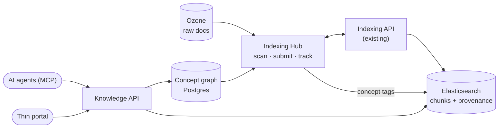

# kb-thinking

企业级金融投资知识库（Knowledge Base）的架构思考与 MVP 规划。

> **状态：架构设计阶段。** 本仓库包含设计文档与概念图谱种子数据，尚未开始系统开发。

## 一句话

从 Apache Ozone 上已有的文档出发，用一个轻量的 **Indexing Hub** 编排现有的 Indexing API 把文档索引进 **Elasticsearch**（带完整溯源），再用一个 **金融投资概念图谱**（PostgreSQL）给 AI Agent 装上"投资顾问的大脑"，通过统一的 **Knowledge API / MCP** 对外提供检索与问答。

## 文档目录

| # | 文档 | 内容 |
|---|---|---|
| 01 | [MVP 架构](docs/01-mvp-architecture.md) | 核心假设、组件、三条主线（索引 / 概念 / 查询） |
| 02 | [Indexing Hub](docs/02-indexing-hub.md) | 编排职责、任务状态机、Indexing API 接口要求、溯源 metadata |
| 03 | [金融投资概念图谱](docs/03-concept-graph.md) | "顾问大脑"：基础层 + 递增层、关系类型、数据模型、Agent 用法 |
| 04 | [Knowledge API 与访问层](docs/04-knowledge-api-and-access.md) | API / MCP 工具、轻量 Portal、权限、回答层护栏 |
| 05 | [MVP 计划](docs/05-mvp-plan.md) | 范围取舍、分阶段计划、成功指标、待决问题、风险 |
| 06 | [架构决策记录](docs/06-decisions.md) | 已定的关键决策及理由 |
| 07 | [远期目标架构](docs/07-target-architecture.md) | Iceberg + Ozone 底座、Starburst、ES vs Doris 等长期方向（非 MVP） |
| 08 | [概念图谱：调研与种子](docs/08-concept-graph-seed.md) | 调研结论、五张表、初版数据与验证结果 |
| 09 | [概念图谱建模规则](docs/09-kg-rules.md) | 关系语义、标签分级、置信度、合规措辞（校验器强制） |
| 10 | [概念图谱评审日志](docs/10-kg-review-log.md) | 三轮独立评审的发现与处理 |

## 概念图谱数据

[`kg/`](kg/) 目录包含 PostgreSQL DDL、种子 CSV（v0.3：278 个概念 · 988 个标签 · 450 条关系，分基础 / 进阶 / 完整三个层级，新加坡本地化、中英双语）、参考查询、校验脚本和生成脚本。种子为 `draft`，需专家审核。

## 现有环境（前提）

- **Apache Ozone**：原始文档已存放于此
- **Elasticsearch**：已在使用，版本与 license 待确认
- **Starburst**：已在使用（MVP 暂不纳入索引链路）
- **Indexing API**：现有服务，负责解析、切块、向量化并写入 ES
