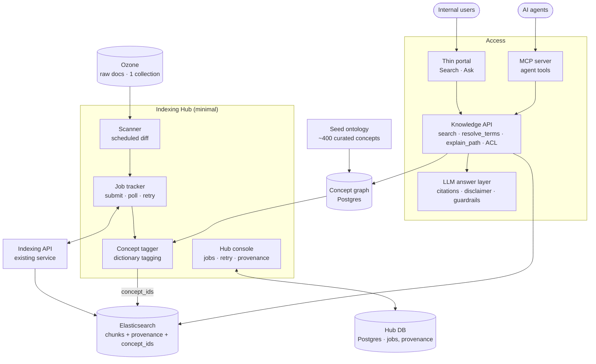
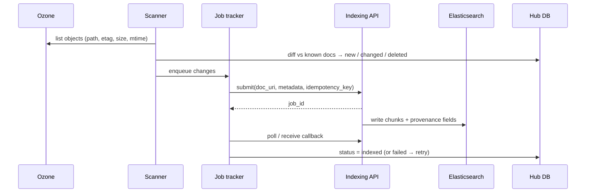
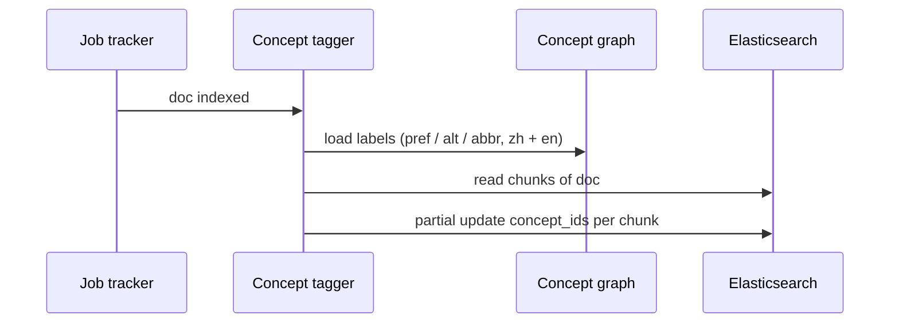
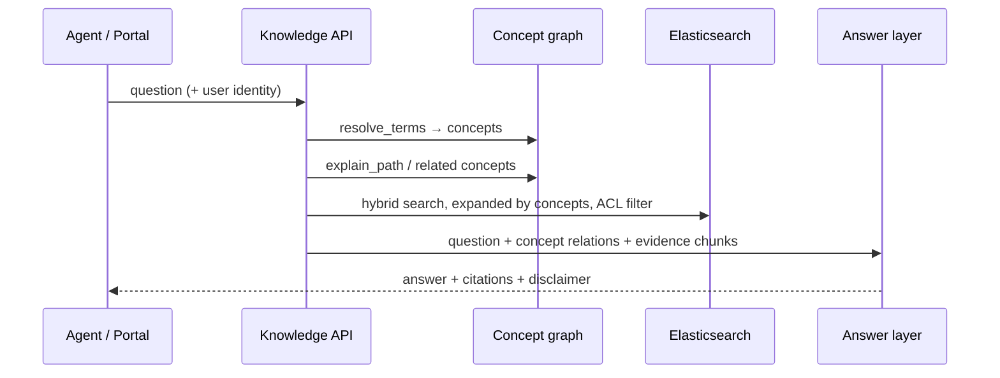

# 01 · MVP 架构

## 1. 要验证的核心假设

> 一个带"金融投资顾问大脑"（概念图谱）的 Agent，在回答投资类问题时，**术语更准确、推理更有依据、引用更可靠**，明显优于只做文档检索的 RAG。

MVP 的原则：**一个文档集合 · 一套精选种子概念 · 一个 Agent 入口**，端到端打通，用评测数据说话。

## 2. 架构总览

> 图中简化为 Hub console ↔ Hub DB；实际上 Scanner、Job tracker、Concept tagger 都会写 Hub DB。

**MVP 之后（不在本期）**：术语自动发现 + 审核流、Graph explore 可视化、文档级 ACL 同步、导出到 Iceberg。见 [05 · MVP 计划](05-mvp-plan.md)。

## 3. 组件职责

| 组件 | 职责 | 不做什么 |
|---|---|---|
| **Ozone** | 原始文档的存放处（已存在） | 不回写任何处理结果 |
| **Indexing Hub** | 发现变更、提交和追踪索引任务、记录溯源、打概念标签、统一管理 | 不自己解析和切块 |
| **Indexing API** | 现有服务：解析、切块、向量化、写入 ES | — |
| **Elasticsearch** | 唯一的检索服务层：BM25 + kNN，承载溯源字段与 `concept_ids` | 不作为主数据 |
| **Hub DB** | 任务状态、溯源台账（Postgres） | 不存文档内容 |
| **Concept graph** | 金融投资概念、术语、关系（Postgres） | 不存具体公司或持仓 |
| **Knowledge API** | 唯一访问入口：检索、概念工具、权限执行 | 不允许绕过它直连 ES / PG |
| **MCP server** | 把 Knowledge API 暴露为 Agent 工具 | — |
| **Thin portal** | 内部用户的 Search / Ask 页面 | MVP 不做图可视化 |
| **Answer layer** | LLM 生成 + 引用 + 基础合规护栏 | 不给个性化投资建议 |

## 4. 三条主线

### 4.1 索引线

### 4.2 概念线

MVP 只做**基于词典的标注**；从文档中自动发现新术语、新关系属于 MVP 之后的工作。

### 4.3 查询线

## 5. 设计边界

- **Ozone 只读**：MVP 不把处理结果存回 Ozone，但 ES 中每个 chunk 都能追溯到 Ozone 对象及其版本。
- **ES 由 Indexing API 写入**；Concept tagger 只对 `concept_ids` 字段做局部更新（写入方式待与 Indexing API 负责方确认，见 [05](05-mvp-plan.md#5-第-0-阶段必须回答的问题)）。
- **权限只在 Knowledge API 执行一次**；Portal 与 Agent 都不直连存储。
- **Iceberg / Starburst 不在 MVP 链路上**；Hub DB 与概念图谱的数据模型按"将来可导出到 Iceberg"的方式设计，见 [07](07-target-architecture.md)。
