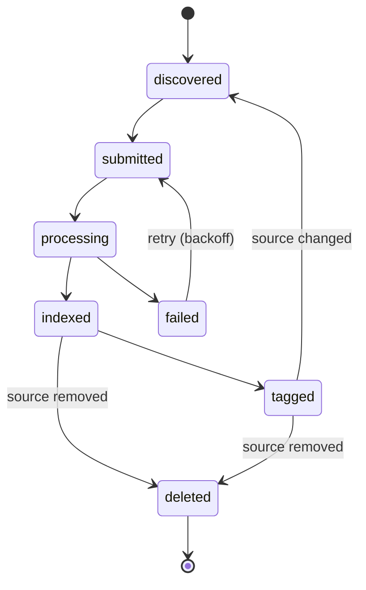

# 02 · Indexing Hub

Indexing Hub 是一个**编排与管理服务**：真正的索引工作由现有的 Indexing API 完成，Hub 只负责"发送、追踪、统一管理"，并保证每条索引结果可溯源。

## 1. 职责

| 模块 | 职责 |
|---|---|
| **Scanner** | 定时列出 Ozone 上指定集合的对象，与 Hub DB 比对 `path + etag/hash`，找出新增、修改、删除 |
| **Job tracker** | 以幂等键提交任务；通过回调或轮询追踪状态；失败自动重试；源文件删除时调用删除接口 |
| **Concept tagger** | 文档索引完成后，按概念词典给 chunk 打 `concept_ids` 标签 |
| **Hub console** | 全局进度、失败列表与一键重试、单文档溯源详情 |
| **Hub DB** | 任务与溯源台账（Postgres） |

## 2. 文档任务状态机

- 重试设上限；超过上限进入人工处理，在 console 中可见。
- `source changed` 时以新的 `etag/hash` 重新走一遍；旧版本 chunk 由 Indexing API 按 `doc_id` 覆盖或删除。

## 3. 对现有 Indexing API 的接口要求

> 以下需在第 0 阶段与 Indexing API 负责方逐项确认。

| 能力 | 为什么需要 | 若不支持的退路 |
|---|---|---|
| 提交时可传幂等键（`doc_id + etag`） | 重复提交不产生重复数据 | Hub 侧去重，提交前先查状态 |
| 自定义 metadata 透传到每个 chunk | 溯源字段要落到 ES | 索引后由 Hub 对 ES 做局部更新 |
| 状态查询或回调 | Hub 追踪进度 | 只能轮询 |
| 按 `doc_id` 删除 | 源文件下线时同步删除 | Hub 直接对 ES `delete_by_query`（需写权限） |
| 返回 chunk ID、页码、位置 | 精确溯源；概念证据也需要 | 溯源只能做到文档级 |
| 允许更新 chunk 的 `concept_ids` | 概念标签写回 | Hub 直接对 ES 局部更新 |

## 4. 溯源 metadata

每个 ES chunk 携带以下字段；Hub DB 保留完整台账。

| 类别 | 字段 |
|---|---|
| 来源 | `source_uri`（Ozone 路径）、`source_etag` / `content_hash`、`source_version_id`（若可用）、`source_modified_at` |
| 处理 | `job_id`、`indexed_at`、`pipeline_version`（解析器 + embedding 模型版本） |
| 位置 | `doc_id`、`chunk_id`、`page`、`offset` |
| 概念 | `concept_ids` |
| 权限 | `acl_groups`（MVP 为集合级） |

**溯源可靠性的前提**：MVP 不回存原文，若 Ozone 上的文件被覆盖，溯源会指向已变化的文件。

- 优先确认 Ozone bucket 能否保留对象版本，并记录 `source_version_id`；
- 否则至少记录 `content_hash`，Scanner 发现不一致时标记旧结果失效并触发重新索引。

## 5. Hub DB 逻辑模型（草案）

| 实体 | 关键属性 |
|---|---|
| `sources` | 集合 ID、Ozone 路径前缀、默认 ACL、解析配置、目标 ES 索引 |
| `documents` | `doc_id`、`source_uri`、`etag/hash`、`version_id`、当前状态、最近任务 |
| `jobs` | `job_id`、`doc_id`、提交时间、状态、重试次数、错误信息、`pipeline_version` |
| `chunks_ledger` | `doc_id`、`chunk_id`、页码、位置、ES 文档 ID |
| `tagging_runs` | `doc_id`、词典版本、标注时间、标签数量 |

## 6. Hub console（MVP 范围）

1. **总览**：已索引 / 处理中 / 失败数量，索引新鲜度
2. **任务列表**：按状态过滤，失败原因，一键重试
3. **文档详情**：Ozone 路径与版本 → 任务历史 → chunk 列表 → ES 文档 ID → 概念标签

MVP 之后再加：概念审核队列、来源配置管理界面、蓝绿重建索引。
