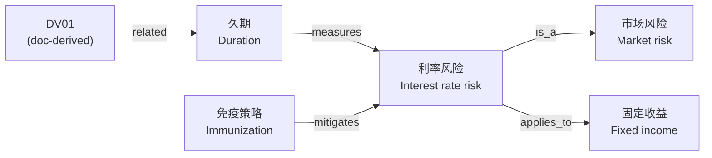

# 03 · 金融投资概念图谱（Agent 的"顾问大脑"）

## 1. 定位

这是一张**概念图谱**：只包含金融投资的**概念、术语及其关系**，不包含具体公司、证券或持仓。目标是让 Agent 像一名投资顾问那样：

- **懂术语**：中英文、别名、缩写都能识别并对齐到标准概念
- **懂逻辑**：知道概念之间的上下位、因果、度量、对冲关系，作为推理骨架
- **讲得准**：使用统一的定义，减少幻觉



## 2. 两层结构

| 层 | 来源 | 写入方式 |
|---|---|---|
| **基础层（base）** | 人工精选的种子本体 | 专家审核后入库，版本化管理 |
| **递增层（doc）** | 从文档内容中发现的新术语、别名、定义、关系 | 带证据进入审核队列，通过后生效；**永不自动覆盖基础层** |

> MVP 只建基础层并用于 chunk 标注；递增层的自动发现属于 MVP 之后。

## 3. 基础层内容

### 3.1 概念分类（scheme）

| 分类 | 示例 |
|---|---|
| 资产类别 | 权益、固定收益、现金、另类投资 |
| 产品与工具 | 股票、债券、基金、ETF、期权、结构化产品 |
| 风险 | 市场风险、利率风险、信用风险、流动性风险、汇率风险 |
| 指标 | 收益率、波动率、夏普比率、最大回撤、久期、Beta |
| 策略与配置 | 资产配置、分散化、再平衡、定投、对冲 |
| 宏观因素 | 利率、通胀、经济周期、货币政策 |
| 适当性 | 风险承受能力、投资期限、流动性需求、投资者分类 |
| 行为金融 | 损失厌恶、羊群效应、过度自信 |

MVP 种子范围建议：约 **400 个概念**，覆盖前 6 类。

### 3.2 关系类型（固定集合）

| 关系 | 含义 | 示例 |
|---|---|---|
| `is_a` | 上下位 | 利率风险 is_a 市场风险 |
| `part_of` | 组成 | 久期 part_of 债券分析 |
| `measures` | 度量 | 久期 measures 利率风险 |
| `affects` | 影响（带正负方向） | 利率 affects(−) 债券价格 |
| `mitigates` | 缓释 | 分散化 mitigates 非系统性风险 |
| `applies_to` | 适用对象 | 利率风险 applies_to 固定收益 |
| `suitable_for` | 适当性匹配 | 低波动产品 suitable_for 保守型投资者 |
| `opposite_of` | 相对概念 | 主动管理 opposite_of 被动管理 |
| `related` | 弱关联 | DV01 related 久期 |

关系类型越少，Agent 推理越稳定；新增关系类型需经评审。

### 3.3 基础层来源

- **FIBO**（EDM Council 维护的开源金融本体）作为金融工具类概念的骨架；协议以官方仓库为准
- **内部术语表、投资方法论、产品说明**——最有价值的部分
- **LLM 起草 + 专家审核**：LLM 生成候选概念、定义、关系，投资专家逐条确认
- **版权注意**：不整本导入 CFA 教材、Investopedia 等受版权保护的内容

### 3.4 多语言与别名

每个概念有中英文首选名、别名、缩写，例如"夏普 / Sharpe / SR"指向同一概念，用于术语识别与检索扩展。

## 4. 递增层（MVP 之后）

文档完成索引后，从 ES 读取 chunk：

1. **发现新知识**：新术语、新别名、内部语境下的定义、新的概念关系 → 挂靠已有概念 → 带证据与置信度进入审核队列
2. **审核**：在 Hub console 中由概念负责人确认 / 驳回
3. **冲突处理**：与基础层矛盾时生成冲突记录，不覆盖

## 5. 数据模型（Postgres，草案）

```sql
-- 逻辑模型草案，仅用于架构说明
CREATE TABLE kg.concepts (
  concept_id     text PRIMARY KEY,
  scheme         text,        -- asset_class / instrument / risk / metric / strategy / macro / suitability / behavioral
  pref_zh        text,
  pref_en        text,
  definition_zh  text,
  definition_en  text,
  layer          text,        -- base / doc
  status         text,        -- confirmed / pending / rejected
  version        int
);

CREATE TABLE kg.labels (       -- 同义词、缩写，用于术语识别
  concept_id  text REFERENCES kg.concepts,
  label       text,
  lang        text,            -- zh / en
  kind        text             -- pref / alt / abbr
);
-- 模糊匹配：pg_trgm 的 GIN 索引

CREATE TABLE kg.relations (
  src         text,
  rel         text,            -- 固定关系集合
  dst         text,
  direction   smallint,        -- affects 的正负：+1 / -1
  layer       text,
  confidence  real,
  status      text,
  PRIMARY KEY (src, rel, dst)
);

CREATE TABLE kg.evidence (     -- 递增层的出处
  concept_id  text,
  src text, rel text, dst text,
  doc_id      text,
  chunk_id    text,
  quote       text,
  job_id      text
);
```

- 遍历使用普通表 + 递归 CTE（1–3 跳足够）；MVP 不引入 Apache AGE。
- 概念图谱与 Hub DB 可以同属一个 Postgres 集群，但分开 database。

## 6. Agent 如何使用

| 工具 | 作用 |
|---|---|
| `resolve_terms(text)` | 把问题中的说法映射为标准概念（"加息" → 利率上升） |
| `get_concept(id)` | 定义、上下位概念、相关指标 |
| `explain_path(a, b)` | 两个概念之间的关系链，作为推理依据 |
| `expand_query(concepts)` | 用同义词和相关概念扩展 ES 检索 |

**示例**："加息对我的债券基金有什么影响？"

1. `resolve_terms` → 利率上升、固定收益基金
2. `explain_path` → 利率 affects(−) 债券价格；久期 measures 利率风险
3. `expand_query` → 用"利率风险""久期"扩展检索，找到相关研报与产品资料
4. 回答层结合 **概念关系（推理）+ 定义（术语）+ 文档证据（引用）** 生成回答

## 7. 边界

这个"大脑"让 Agent 懂投资知识，**不等于可以直接给客户个性化投资建议**。适当性匹配、风险提示、合规话术作为独立的规则层，放在回答生成之后把关（见 [04](04-knowledge-api-and-access.md#4-回答层与合规护栏)）。
