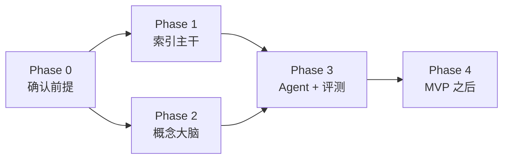

# 05 · MVP 计划

> 本文只做规划，不推进任何开发。

## 1. 范围取舍

| 做（MVP） | 不做（MVP 之后） |
|---|---|
| Ozone 上**一个**文档集合，几千份文档量级 | 多数据源、实时通道 |
| Hub 最小功能：定时比对、提交与追踪、失败重试、溯源 | 复杂调度、蓝绿重建索引自动化 |
| ES 携带溯源字段与 `concept_ids` | 完整反馈闭环 |
| **人工精选**约 400 个种子概念，6 个分类，中英文 | 从文档自动发现新术语 + 审核流 |
| 词典匹配给 chunk 打概念标签 | LLM 抽取新的概念关系、一词多义消歧 |
| Knowledge API + MCP 工具作为主入口 | Graph explore 可视化 |
| 轻量 Portal（Search + Ask） | 完整 Portal |
| 集合级粗粒度权限 | 文档级 ACL 同步 |
| 基础护栏：引用、免责声明、不给个性化建议 | 完整适当性规则引擎 |

## 2. 分阶段计划

第 1、2 阶段可并行：索引主干偏工程，概念大脑偏专家工作。

### Phase 0 · 确认前提（约 1–2 周）

只做调研与决策，回答 [第 5 节](#5-第-0-阶段必须回答的问题) 的问题，并启动评测集准备。

- **出口**：阻塞问题全部有结论；选定文档集合；概念负责人到位；评测集已启动

### Phase 1 · 索引主干

Scanner、Job tracker、Hub DB、最小 console，对接现有 Indexing API。

- **出口**：集合内文档 100% 完成索引；失败可见、可重试；ES 中任意结果可追溯到 Ozone 对象及版本

### Phase 2 · 概念大脑

专家审核约 400 个种子概念（定义、中英文别名、固定关系），入库 Postgres；词典标注 chunk。

- **出口**：专家签字确认种子本体；抽样标注准确率达到约定目标

### Phase 3 · 开放给 Agent 并评测

Knowledge API、MCP 工具、轻量 Portal、基础护栏。

- **出口**：在评测集上完成 A/B 对比——**纯检索 RAG** vs **检索 + 概念大脑**——提升可量化

### Phase 4 · MVP 之后

按评测结论排序：术语自动发现与审核、Graph explore、文档级 ACL、导出到 Iceberg、扩展数据源。

## 3. 成功指标（目标值在 Phase 0 确定）

| 维度 | 指标 |
|---|---|
| 检索 | 评测集 Recall@10 |
| 回答 | 投顾打分的正确率、引用准确率、术语使用准确率 |
| 对比 | 概念大脑带来的提升幅度（MVP 最关键结论） |
| 运维 | 索引新鲜度（文件变更 → 可检索）、任务失败率 |

## 4. 评测集

由投资顾问提供约 **100 个真实问题 + 标准答案**，覆盖三类：

1. **概念解释**：什么是久期？夏普比率怎么看？
2. **因果推理**：加息对债券基金有什么影响？
3. **产品比较**：两类产品的风险收益特征差异

评测集决定 MVP 能否得出有说服力的结论，是 Phase 0 的出口条件。

## 5. 第 0 阶段必须回答的问题

| 问题 | 为什么阻塞 |
|---|---|
| Indexing API 是否支持幂等键、metadata 透传、状态回调、删除？是否返回 chunk 位置？是否允许更新 `concept_ids`？ | 决定 Hub 设计与溯源粒度（见 [02](02-indexing-hub.md#3-对现有-indexing-api-的接口要求)） |
| ES 的版本与 license？ | 决定 kNN、文档级安全等能力 |
| Ozone 能否保留对象版本？ | 决定溯源是否可靠 |
| 种子概念由谁负责、谁审核？ | 没有专家投入，概念大脑就是空的 |
| **用户是内部投顾，还是终端客户？** | 合规要求差别极大，决定护栏的重量 |
| 可使用哪个 LLM 与 embedding 模型？ | 影响部署方式与数据边界 |
| MVP 用哪个文档集合？ | 需有代表性，且能配出评测问题 |

## 6. 关键风险

| 风险 | 应对 |
|---|---|
| 种子概念质量不足，或专家没有时间 | Phase 0 锁定负责人；LLM 起草、专家只做审核 |
| Indexing API 能力不足，溯源做不细 | Phase 0 先确认；缺失部分由 Hub 补充记录 |
| 词典标注误判（一词多义） | 抽样评估；MVP 之后引入 LLM 消歧 |
| 被当作投资建议工具使用 | 先限定内部用户；上线基础护栏 |
| 评测集迟迟拿不到 | 作为 Phase 0 出口条件 |
