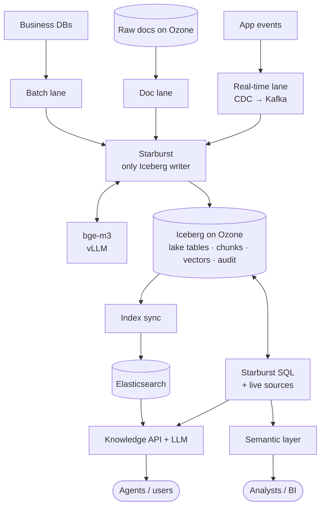

# 07 · 远期目标架构（非 MVP）

> 本文记录在 MVP 之前讨论过的长期方向，供演进参考，**不属于 MVP 范围**。

## 1. 底座：Iceberg + Ozone + Catalog

| 组件 | 角色 |
|---|---|
| **Apache Ozone** | 对象存储：原始文档、Parquet 数据文件（通过 S3 Gateway 访问） |
| **Apache Iceberg** | 表格式：快照、schema 演进、时间旅行；唯一主数据 |
| **Catalog** | 记录每张表当前指向的快照 |

- 向量也存入 Iceberg（`array(real)`，按模型版本分区）：ES / Doris 坏了或换模型时，可直接重建索引而无需重新计算 embedding。
- ES、Doris、图存储都是**可重建的服务层索引**。

## 2. Starburst 的角色

- **唯一的 Iceberg 写入者**：所有通道（Batch、Doc、Real-time）都经 Starburst `INSERT/MERGE` 写入，权限、审计、血缘集中。
- **Catalog**：只有 Starburst 读写 Iceberg 时，使用 Starburst Metastore 即可；若引入 Doris 等其他引擎，迁移到独立的 Iceberg REST Catalog（如 Gravitino、Polaris），用 `register_table` 重新注册，无需移动数据。
- **AI SQL**：`starburst.ai.generate_embedding()`、Iceberg 表上的 `generate_embeddings` 存储过程，可对接 OpenAI 兼容端点上的本地模型（如 vLLM 部署的 bge-m3）。
- **联邦查询**：同时查询 Iceberg 与 ERP / CRM 等在线源，服务 BI 与 text-to-SQL。

参考：[Starburst AI functions](https://docs.starburst.io/latest/starburst-ai/functions-ai.html) · [Configure Starburst AI](https://docs.starburst.io/latest/starburst-ai/configuration-ai.html) · [Iceberg connector](https://docs.starburst.io/latest/connector/iceberg.html)

## 3. 目标数据流

## 4. 检索服务层：ES vs Doris

当前已有 Starburst 与 ES（版本未知），三种选项：

| 选项 | 适用条件 | 优点 | 缺点 |
|---|---|---|---|
| **A. ES + Starburst**（推荐起步） | ES ≥ 8.x 且有相应 license，BI 并发不高 | 复用现有系统；搜索能力最强 | 检索结合业务数据需两步；Starburst 不适合高并发看板 |
| **B. 仅 Doris** | ES 版本旧 / 无 license / 已超负荷 | 一条 SQL 完成 BM25 + ANN + 过滤 + join；兼做 BI 服务 | 新引擎运维；搜索调优不如 ES |
| **C. Doris + ES** | 丰富搜索与高并发亚秒 BI 都是硬需求 | 各取所长 | 两条同步、两套权限；必须严格分工，chunk 不能两边都建 |

判断依据：ES 版本与 license（`GET /`、`GET _license`）、是否有高并发 BI、检索偏文本还是偏过滤 / join、团队能运维几套系统。

## 5. 治理

- **身份**：IdP（OIDC）+ SCIM；Agent 以 on-behalf-of 调用，不用大权限服务账号
- **权限**：RBAC 管"谁"，标签 ABAC 管"什么"；执行点包括 Starburst、ES、（未来的）Doris 和回答层
- **知识库特有**：权限撤销延迟需设 SLA；embedding 继承源文档密级；派生数据按最高敏感级继承
- **血缘**：OpenLineage 统一采集，汇聚到 DataHub / OpenMetadata；延伸到 RAG 链路（文档 → chunk → 向量 → 检索 → 回答），用 `answer_audit` 记录每次回答
- **删除传播**：沿血缘清除 chunk、向量、索引与缓存

## 6. 从 MVP 演进到目标架构

| MVP 现状 | 演进动作 |
|---|---|
| Hub DB 溯源台账 | 定期导出到 Iceberg，成为血缘与审计数据的一部分 |
| Postgres 概念图谱 | 定期快照到 Iceberg，供分析与版本回溯 |
| Indexing API 直接写 ES | 视需要改为：结果先经 Starburst 落 Iceberg，再同步 ES |
| 集合级 ACL | 接入 IdP 组 + 文档级 ACL 同步 |
| 单一文档集合 | 按 Batch / Real-time / Doc 三条通道扩展数据源 |
