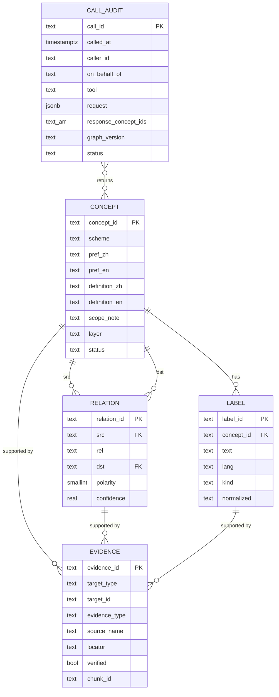
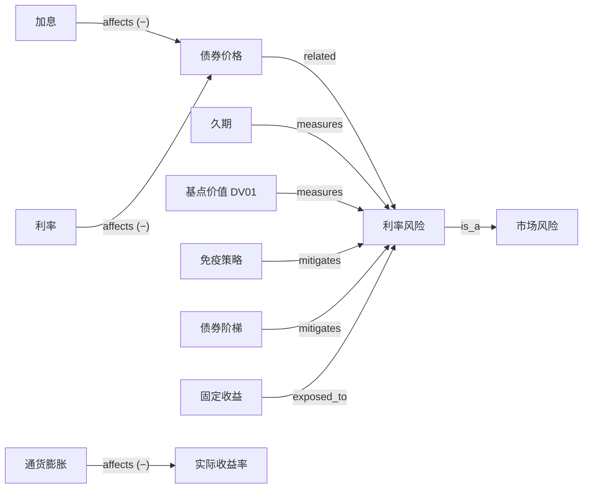

# 08 · 金融投资概念图谱：调研与种子

> 本文记录 v0.1 的调研与初版数据；v0.2 / v0.3 的修订见 [10 · 评审日志](10-kg-review-log.md)，建模规则见 [09](09-kg-rules.md)。当前数据以 `kg/seed/` 为准（v0.3：278 个概念，三个层级）。

本文记录概念图谱的调研结论、五张表的数据模型、种子数据 v0.1 的内容与验证结果。数据与脚本位于 [`kg/`](../kg/)。

> **状态**：种子 v0.1，全部为 `draft`（LLM 起草），**需投资专家逐条审核后才能用于生产**。

## 1. 调研结论

| 来源 | 是什么 | 许可 | 在本项目中的用法 |
|---|---|---|---|
| **W3C SKOS** | 知识组织体系的标准模型：首选名 / 别名 / 隐藏词、上下位、关联、定义、适用说明 | W3C 标准 | **采用其语义**：`label.kind` 对应 prefLabel / altLabel / hiddenLabel；`is_a` 对应 broader；`scope_note` 对应 scopeNote |
| **FIBO**（EDM Council） | 金融业务本体（OWL），覆盖金融工具、业务实体等 | MIT（GitHub 仓库 LICENSE） | 体量大、偏实例建模，**不直接导入**；作为金融工具类概念的核对与对齐参考 |
| **ISO 10962（CFI）** | 金融工具分类标准：权益、债务、集合投资工具、衍生品等 | ISO 付费标准 | 作为 `instrument` 分类骨架的参照 |
| **Investor.gov 术语表**（美国 SEC） | 面向投资者教育的权威术语释义 | 页面未见明确复用声明 | **只作为核对出处**，定义由我们自行撰写，不复制原文 |
| **Wikidata** | 多语言结构化知识库 | CC0 | 后续用于补充多语言标签与外部 ID 对齐 |
| 业界实践 | 近年的投研 Agent 普遍把知识图谱作为 Agent 记忆，强调出处可追溯 | — | 支撑"证据表 + 调用审计"的设计 |

**结论**：不引入重型 OWL 本体，采用 **SKOS 语义 + 少量固定领域关系** 的轻量模型，用 Postgres 承载；外部标准用于核对与对齐，不整体导入。

## 2. 数据模型：五张表



| 表 | 作用 | 要点 |
|---|---|---|
| `kg.concept` | 概念 | 9 个分类；中英文首选名与定义；`layer`（base / doc）；`status` 审核状态 |
| `kg.label` | 术语识别 | `kind` = pref / alt / abbr / hidden；`normalized` 用于匹配；每个概念每种语言恰好一个 pref |
| `kg.relation` | 推理骨架 | 9 种固定关系；`affects` 带正负 `polarity`；`confidence` 表示把握程度 |
| `kg.evidence` | 出处 | `authoring`（谁创建）、`reference`（外部核对源）、`doc_chunk`（文档证据）、`expert_review`（审核结论） |
| `kg.call_audit` | 调用审计 | 每次 Agent / Portal 调用图谱工具都记一行：谁、代表谁、哪个工具、输入、返回的概念与关系、图谱版本、耗时 |

完整 DDL 见 [`kg/schema.sql`](../kg/schema.sql)。

### 2.1 关系类型

| 关系 | 方向与含义 | 种子中的例子 |
|---|---|---|
| `is_a` | src 是 dst 的一种 | 利率风险 → 市场风险 |
| `part_of` | src 是 dst 的组成部分 | 再平衡 → 资产配置 |
| `measures` | 指标 src 度量 dst | 久期 → 利率风险 |
| `affects` | src 影响 dst，`polarity` ±1 | 利率 →(−) 债券价格 |
| `mitigates` | src 缓释风险 dst | 免疫策略 → 利率风险 |
| `exposed_to` | 资产 / 工具 src 承担风险 dst | 固定收益 → 利率风险 |
| `suitable_for` | 产品 src 大致适合投资者类型 dst（仅示意） | 货币基金 → 保守型投资者 |
| `opposite_of` | 对称的相对概念 | 主动投资 ↔ 被动投资 |
| `related` | 对称的弱关联 | 信用周期 ↔ 信用利差 |

### 2.2 调用审计记录什么

| 字段 | 用途 |
|---|---|
| `caller_type` / `caller_id` / `on_behalf_of` | Agent 代表哪位用户调用（身份透传） |
| `channel` / `tool` / `request` | 从哪个入口、调用了哪个工具、参数是什么 |
| `response_concept_ids` / `response_relation_ids` | Agent 实际拿到了哪些概念和关系，可用于回溯回答的推理依据 |
| `graph_version` | 当时服务的图谱版本，支持复现 |
| `status` / `latency_ms` / `error` | 运维与质量监控（如 `empty` 比例高说明术语覆盖不足） |

## 3. 种子 v0.1 内容

| 维度 | 数量 |
|---|---|
| 概念 | **197** |
| 标签 | **692**（中文首选 197、英文首选 197、中文别名 171、英文别名 94、英文缩写 33） |
| 关系 | **265**（is_a 98、related 79、part_of 22、exposed_to 18、mitigates 14、measures 12、affects 11、opposite_of 6、suitable_for 5） |
| 证据 | **659**（概念 authoring 197、概念 reference 197、关系 authoring 265） |

| 分类 | 概念数 | 示例 |
|---|---|---|
| `asset_class` 资产类别 | 11 | 权益、固定收益、现金、另类、黄金 |
| `instrument` 产品与工具 | 40 | 股票、国债、可转债、ETF、货币基金、期权、利率互换、结构性存款 |
| `risk` 风险 | 20 | 系统性 / 非系统性、利率、信用、流动性、通胀、收益顺序风险 |
| `metric` 指标 | 38 | 年化收益、夏普、最大回撤、久期、DV01、信用利差、市盈率 |
| `strategy` 策略与配置 | 24 | 资产配置、分散化、再平衡、定投、免疫策略、债券阶梯 |
| `macro` 宏观因素 | 19 | 利率、加息、通胀、CPI、收益率曲线倒挂 |
| `market` 市场与交易 | 17 | 债券价格、指数、基准、一级 / 二级市场、无风险利率 |
| `suitability` 适当性 | 17 | KYC、风险承受能力、投资期限、投资者风险类型、合格投资者 |
| `behavioral` 行为金融 | 11 | 损失厌恶、羊群效应、处置效应、本土偏好、FOMO |

示例片段（利率相关）：



### 3.1 编写约定

- **ID**：`<分类前缀>.<snake_case>`，如 `risk.interest_rate`、`metric.dv01`
- **定义**：中英文各一句，自行撰写，不复制外部来源原文
- **别名取舍**：宁缺毋滥。已剔除容易误判的别名，例如英文 `PER`（与 per 冲突）、`IR`（常指投资者关系）、`IRR`（通常指内部收益率）、`Call` / `Put` / `Default` / `Margin`（日常词），以及中文的"风险""期限""上市""利差"等过泛词
- **已知歧义**：`PE` 同时指私募股权和市盈率，保留两者并在 `scope_note` 中说明，由标注器结合上下文消歧
- **适当性类概念**：只给出通用的三类投资者类型，并在 `scope_note` 中提示需映射到当地监管等级（如中国大陆的 C1–C5，其中"稳健型"与"平衡型"是不同等级）
- **`suitable_for`**：仅为示意（置信度 0.6–0.7），实际匹配以产品风险等级为准
- **有争议的关系**降低置信度并写明原因，例如"大宗商品缓释通胀风险"（0.6，对冲效果不稳定）、"止损缓释市场风险"（0.7，跳空时可能失效）

### 3.2 证据现状

每个概念有两条证据：
- `authoring`：标明由 seed v0.1 起草、待专家审核
- `reference`：指向核对源与查证词（`lookup_term`），**`verified = false`**

核对源分布：Investor.gov 术语表 110、FIBO 40；宏观（19）、适当性（17）、行为金融（11）三类的权威来源**待选定**，例如央行与统计局术语表、当地监管的适当性规则、行为金融经典文献。

## 4. 验证结果

| 检查 | 结果 |
|---|---|
| `kg/tools/validate.py`：引用完整、每概念每语言一个首选名、关系类型合法、`polarity` 只用于 affects、对称关系不重复、is_a / part_of 无环、每个概念和关系都有 authoring 证据 | 通过（仅 1 条预期内的 `PE` 歧义告警） |
| 在 PostgreSQL 16 上执行 `schema.sql` + `load.sql` | 通过，197 / 692 / 265 / 659 行全部装载，约束无冲突 |
| `kg/queries.sql` 中的 resolve_terms / get_concept / explain_path / expand_query / call_audit | 全部可执行 |
| 示例：`explain_path(加息, 久期)` | `加息 →affects(−)→ 债券价格 →related→ 利率风险 ←measures← 久期`（3 跳） |

**验证中发现的问题**：`pg_trgm` 对中文两字词基本无效（"久期"的相似度为 0），只能做精确匹配。因此：

- 中文术语识别和 chunk 标注应在**标注器端用词典匹配**（如 Aho-Corasick）完成，而不是依赖数据库的模糊匹配
- 若需要数据库端中文模糊匹配，可评估 `pg_bigm` 或中文分词扩展
- 英文模糊匹配可用 `pg_trgm`，但阈值建议从默认 0.3 调高（测试中 "duration" 误召回了 "Deflation"，得分 0.36）

## 5. 如何使用

```bash
python3 kg/tools/validate.py          # 校验 CSV
psql -d <db> -f kg/schema.sql         # 建表
psql -d <db> -f kg/load.sql           # 装载种子（在仓库根目录执行）
```

**CSV 是唯一的事实来源**：专家直接在 `kg/seed/*.csv` 上审核和修改（可以用 Excel 打开），每次修改后跑一遍校验再装载。

## 6. 下一步

1. **专家审核**：按分类分配给审核人，逐条把 `status` 从 `draft` 改为 `confirmed` 或 `rejected`，并为每条审核写一条 `expert_review` 证据
2. **补全核对源**：为宏观、适当性、行为金融选定权威来源；核对 reference 证据，并把 `verified` 改为 `true`
3. **扩充到约 400 个概念**：重点补充本公司产品线相关术语、内部方法论用语
4. **外部对齐**：用 Wikidata（CC0）补充多语言标签；金融工具类概念对齐 FIBO / CFI
5. **标注器**：基于 `label` 表构建词典匹配，抽样评估标注准确率（MVP Phase 2 的出口条件）
